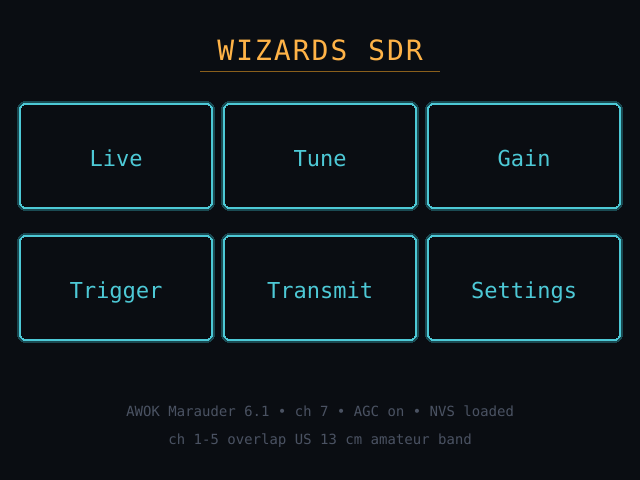
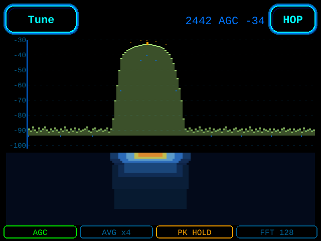
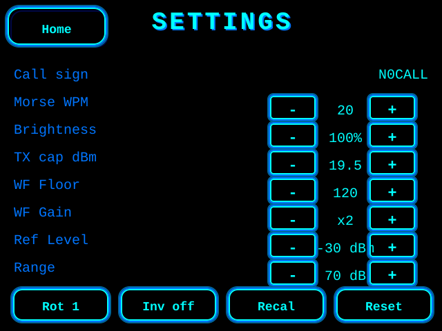

# Wizards SDR

A standalone 2.4 GHz spectrum watcher and CW transmitter for the ESP32-based
"Cheap Yellow Display" (CYD) and the JustCallMeKoko AWOK Marauder 6.1 2.4"
boards. Turns a $10-25 touchscreen board into a self-contained hacker-focused
SDR tool: spectrum view, waterfall, trigger-and-capture, and an on-device
Morse CW keyer for amateur-radio operators.

**No PC required at runtime.** The display is the UI.

## Screens

Rendered at the firmware's real 320×240 dimensions, using the on-device
Wizard color palette (electric blue chrome, cyan highlights, amber for TX
and peak markers, lime for the live trace).

### Home



6-tile launcher — Live, Tune, Gain, Trigger, Transmit, Settings — each tile
drawn with the signature 3-stroke glow (outer dim, middle blue, inner cyan).

### Live — SDR mode



Calibrated dBm Y-axis (−30 to −100 by default, Ref Level + Range both
adjustable from Settings), 10 dB dashed grid, HackRF-style filled bins
rising from the cyan noise-floor dot line, amber max-hold ridge, and a
full-width scanline-batched waterfall. Peak bin wears an amber cap. Pill
strip shows AGC / AVG / PK HOLD / FFT size.

### Settings



Eight adjustable rows (Call sign, Morse WPM, Brightness, TX cap dBm,
Waterfall Floor + Gain, SDR Ref Level + Range) and a 4-pill action row:
**Rot** advances the display orientation and clears touch cal, **Inv**
toggles LCD inversion live, **Recal** restarts the 3-point touch
calibration, **Reset** is a 2-tap armed factory wipe.

## Install (pre-built, no toolchain)

A ready-to-flash merged image is in [`dist/`](dist/):

- **Classic CYD 2.8" (ESP32-2432S028R):** [`wizards-sdr-cyd28_0x0.bin`](dist/wizards-sdr-cyd28_0x0.bin)

Flash at offset `0x0` with any ESP32 tool. Example with `esptool`:

```bash
esptool --chip esp32 --port COM3 write-flash 0x0 wizards-sdr-cyd28_0x0.bin
```

Or drag the file onto <https://espressif.github.io/esptool-js/> (web flasher)
and set the offset to `0x0`.

The image is built `--flash-mode dio --flash-freq 80m --flash-size 4MB` and
includes bootloader + partitions + boot_app0 + app in one 923 KB file.

## Hardware

| Board | MCU | Panel | Antenna | Env |
|---|---|---|---|---|
| Classic CYD (ESP32-2432S028R) | ESP32-WROOM-32 | ILI9341 320×240 | PCB trace | `cyd28-signalhound` |
| AWOK Marauder 6.1 2.4" | ESP32-WROOM-32 | ILI9341 240×320 | SMA (external) | `awok-signalhound` |

The AWOK board has SMA connectors — recommended if you want any real reach.

## Features

### Spectrum view ("Live")
- Calibrated **dBm Y-axis** (default -30 to -100 dBm, user-adjustable Ref Level + Range)
- 10 dB dashed grid lines with labeled dBm values
- Three overlaid traces: live (green), per-bin slow-average noise floor (cyan), persistent max-hold ridge (amber)
- HackRF-style filled bins — each column visualizes SNR above the floor
- Full-width scanline-batched waterfall at ~60 Hz (ILI9341 DMA path)
- Per-channel peak-dBm readout
- Auto-rotating display (portrait or landscape, cycled from Settings)

### Trigger / Capture
- Edge-triggered threshold with hysteresis + band-gating (full / lower / upper half)
- Capture ring buffer with event metadata (peak, band, channel, 64-bin sparkline)
- Optional SD-card mirror (AWOK: shared VSPI; Classic: dedicated bus)

### Transmit (ham-licensed operators only)
- Real CW tone via Espressif's vendored `cert_test` RF path (`esp_phy_wifi_tx_tone`)
- Morse CW keyer: 5-30 WPM, PARIS-timed, preset templates with call-sign substitution
- 802.11 PKT20 and BT CW+Sweep modes
- Transmit-power cap (0.25 dB resolution, 10-19.5 dBm range)
- Reverse-engineered on-chip channel redirect via `--wrap=RFChannelSel` linker intercept

### Settings
- Call sign (used by Morse presets)
- Morse WPM, Brightness, TX cap
- Waterfall contrast (floor + gain)
- SDR plot Ref Level + Range (dBm scale)
- Display rotation + inversion
- Touch recalibration, factory reset

## Build + flash

```bash
pio run -e cyd28-signalhound -t upload     # Classic CYD
pio run -e awok-signalhound  -t upload     # AWOK Marauder 6.1
pio device monitor
```

Erase before first upload if migrating from another firmware (stale NVS can
poison the touch cal and boot path):

```bash
pio run -e <env> -t erase && pio run -e <env> -t upload
```

## Pinout

### Classic CYD 2.8" (ESP32-2432S028R)

| Role | Pins |
|---|---|
| TFT (HSPI) | MOSI 13 · MISO 12 · SCLK 14 · CS 15 · DC 2 · BL 21 |
| Touch (VSPI) | SCK 25 · MOSI 32 · MISO 39 · CS 33 · IRQ 36 |
| SD (VSPI shared) | MOSI 23 · MISO 19 · SCLK 18 · CS 5 |

### AWOK Marauder 6.1 2.4"

| Role | Pins |
|---|---|
| TFT (shared VSPI) | MOSI 23 · MISO 19 · SCLK 18 · CS 17 · DC 16 · RST 5 · BL 32 |
| Touch (same VSPI) | CS 21 |
| SD (same VSPI) | CS 14 |

## Design notes

- **Dual-core discipline:** Core 0 owns the RF task (phy, cert_test, FFT),
  Core 1 owns the UI (TFT, touch, NVS). A single-slot FreeRTOS queue
  (`xQueueOverwrite`) passes frames across — capture never waits on UI,
  UI never blocks on capture.
- **No full-screen repaints** at frame rate; waterfall uses batched
  `setAddrWindow` + `pushColors` scanline pushes (~36 pushes per frame
  vs. ~4,600 individual `drawFastVLine` calls).
- Touch calibration is **rotation-specific**; changing orientation
  clears the cal and reboots into the 3-point calibration flow.

## Attribution

Wizards SDR builds on and depends on several open-source projects:

### Vendored binary libraries

- **`lib/cert_test/librftest.a`** and **`libbttestmode.a`** are prebuilt from
  Espressif's `esp-phy-lib` (RF certification test blobs). These provide the
  `esp_phy_wifi_tx_tone` / `esp_phy_bt_tx_tone` entry points used by the
  Transmit screen's real CW tone output. Licensed under Apache 2.0.
  Source: <https://github.com/espressif/esp-phy-lib>

### Runtime library

- **TFT_eSPI** by Bodmer — ILI9341 driver, touch (XPT2046), font engine.
  Licensed under BSD-style terms. Source: <https://github.com/Bodmer/TFT_eSPI>

### Framework and toolchain

- **ESP32 Arduino core** by Espressif Systems. Source: <https://github.com/espressif/arduino-esp32>
- **pioarduino** build platform. Source: <https://github.com/pioarduino/platform-espressif32>
- **PlatformIO** build system. Source: <https://platformio.org/>

### Research and inspiration

Transmit-side techniques were informed by prior ESP32 SDR work. Wizards SDR
on classic ESP32 uses a different approach (`--wrap=RFChannelSel` linker
intercept over `cert_test`'s existing WiFi channel grid) but these projects
proved the broader space is reachable:

- **Jochen Hoenicke's esp-sdr-tx** — polar-mod CW transmit on ESP32-S3 via
  `start_tx_tone_step` + `force_tx_gain` + direct SDM I2C writes.
  <https://github.com/jhoenicke/esp-sdr-tx>
- **ESPARGOS** (CSI-based receiver work on ESP32) — pointer to the broader
  undocumented register surface. <https://espargos.net/>
- **Ragnar** — ESP-SDR firmware exploring undocumented DUMP registers.

### Hardware

- **ESP32-2432S028R** ("Cheap Yellow Display") — see
  <https://github.com/rzeldent/esp32-smartdisplay> for the hardware reference.
- **AWOK Marauder 6.1** — JustCallMeKoko's open-hardware Marauder board.
  <https://github.com/justcallmekoko/ESP32Marauder>

## License

Apache License 2.0. See [LICENSE](LICENSE) for the full text and [NOTICE](NOTICE)
for the attribution breakdown. The vendored binary libraries in `lib/cert_test/`
retain their own Apache 2.0 license from Espressif Systems.

## Legal and operational notes

The Transmit screen's CW keyer can emit a continuous carrier on the 2.4 GHz
ISM band. US WiFi channels 1-5 (2401-2451 MHz) overlap the US 13 cm amateur
band — operation under an amateur radio license as a licensed operator is
legal, but **unlicensed CW transmission on these frequencies is not**. The
firmware will not transmit without a user-set call sign.

The Classic ESP32 is permanently capped at the WiFi (5 MHz grid, ch 1-14)
and BT (1 MHz grid, 2402-2480 MHz) channel rasters — libphy's internal
commit path overrides any attempt to steer the PLL off-grid. Arbitrary-
frequency TX on classic ESP32 is not reachable without a full libphy
source rebuild. S3 CYD support is planned; see `specs/signalhound-s3.html`.
